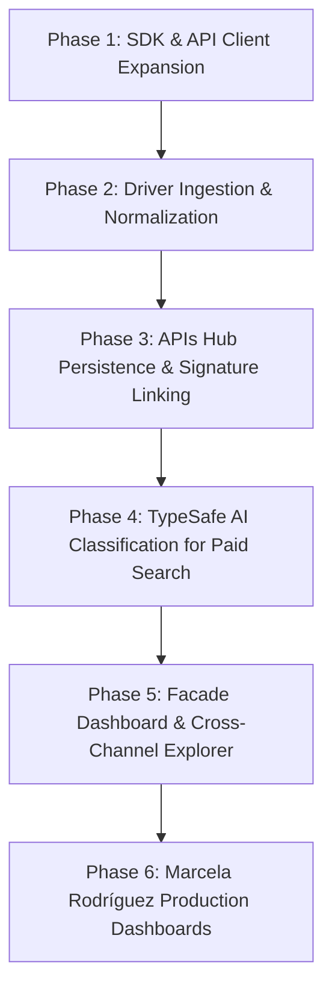

# Google Ads Full Expansion & Search Terms Intelligence: Roadmap & Implementation Plan

**Target Repositories:**
- `google-api-anibal` (`SDK`)
- `google-hub-driver` (`Driver`)
- `apis-hub` (`Orchestrator / Engine`)
- `apis-hub-facade` (`Business & UI`)

---

## 1. Executive Summary & Vision

This plan details the full expansion of **Google Ads** within the APIs Hub SaaS hierarchy, upgrading it from a baseline hierarchy integration (Campaign, Ad Group, Ad, Device) to a comprehensive, multi-channel performance and semantic intelligence suite:
1. **Search Terms / Queries Ingestion:** Ingesting user search terms (`search_term_view`) linked to campaigns and ad groups.
2. **Universal Query Entity Mapping:** Connecting Google Ads queries into the existing universal `queries` table and `metric_configs.query_id` without database schema changes.
3. **TypeSafe AI Semantic Classification:** Extending AI classification (Intent, Brand Relation, Business Relevance, and Negative Keyword Qualification) to Google Ads search terms.
4. **Campaign Type & Multi-Format Diversification:** Adding first-class support for YouTube/Video metrics (`video_views`, `cpv`, completion quartiles), Performance Max (PMax), Display, and Local/Call campaigns.
5. **Cross-Channel SEO + Paid SERP Intelligence:** Enabling unified dashboards combining Google Search Console (Organic) and Google Ads (Paid) on shared queries.

---

## 2. Phase-by-Phase Roadmap



| Phase | Core Objective | Key Deliverables | Risk Level |
|:---:|---|---|:---:|
| **Phase 1** | SDK GAQL Endpoints | Add `search_term_view`, video metrics, and campaign type queries to `google-api-anibal`. | Low |
| **Phase 2** | Driver Conversion & Profiles | Implement `searchTermMetrics()`, video metrics conversion, and update metric profiles in `google-hub-driver`. | Medium |
| **Phase 3** | Persistence & Entity Linking | Map `search_term` to universal `Query` in `MarketingProcessor` without altering database schema. | Low |
| **Phase 4** | TypeSafe AI Evaluation | Expand `QueryClassificationService` and `app:classify-queries` to classify Google Ads queries. | Medium |
| **Phase 5** | Facade UI & Data Explorer | Add "Search Terms / Queries" tab, Intent filters, and Wasted Spend table in `apis-hub-facade`. | Low |
| **Phase 6** | Marcela Rodríguez Rollout | Build the 8-block Production Dashboard and 9-block Technical Dashboard in production. | Low |

---

## 3. Detailed Implementation Steps

### Phase 1: SDK & API Client Expansion (`google-api-anibal`)

- **File:** `src/Services/GoogleAds/GoogleAdsApi.php`
- **Actions:**
  1. Add `getSearchTerms(string $customerId, string $startDate, string $endDate, array $fields = [], string $where = "")`:
     - Default GAQL query:
       ```sql
       SELECT
           search_term_view.search_term,
           search_term_view.status,
           campaign.id,
           campaign.name,
           ad_group.id,
           ad_group.name,
           segments.date,
           segments.device,
           metrics.cost_micros,
           metrics.impressions,
           metrics.clicks,
           metrics.conversions,
           metrics.conversions_value
       FROM search_term_view
       WHERE segments.date >= :startDate AND segments.date <= :endDate
       ```
  2. Add Video / YouTube Metrics query support to `getMetricsForLevel()`:
     - Allow requesting `metrics.video_views`, `metrics.video_quartile_p25_rate`, `metrics.video_quartile_p50_rate`, `metrics.video_quartile_p75_rate`, `metrics.video_quartile_p100_rate`, and `metrics.average_cpv`.
  3. Ensure `advertising_channel_type` and `advertising_channel_sub_type` are selectable on campaign calls.

---

### Phase 2: Driver Ingestion & Normalization (`google-hub-driver`)

- **Files:**
  - `src/Conversions/GoogleAdsMetricConvert.php`
  - `src/Conversions/GoogleAdsEntityConvert.php`
  - `src/Drivers/GoogleAdsDriver.php`
- **Actions:**
  1. **Metric Profiles:**
     In `GoogleAdsDriver::getMetricProfiles()`:
     Add profile `google_ads_search_term`:
     ```php
     MetricProfileTemplates::searchTermBreakdown(
         channel: 'google_ads',
         key: 'google_ads_search_term',
         label: 'Google Ads Search Terms'
     )
     ```
  2. **Canonical Metric Dictionary:**
     Add canonical mappings:
     ```php
     'video_views'   => ['metrics.video_views', 'video_views'],
     'average_cpv'   => ['metrics.average_cpv', 'average_cpv'],
     'search_term'   => ['search_term_view.search_term', 'query'],
     ```
  3. **Metric Converter:**
     In `GoogleAdsMetricConvert.php`, implement `searchTermMetrics()`:
     - Map `search_term_view.search_term` into `row['query']`.
     - Set universal context:
       ```php
       'level' => 'search_term',
       'query' => $row['query'],
       'channeledCampaignId' => $row['campaign.id'],
       'channeledAdGroupId' => $row['ad_group.id'],
       ```
  4. **Driver Sync Flow:**
     In `GoogleAdsDriver::syncMetrics()`, add dispatching for search terms when granular sync or query profiling is active.

---

### Phase 3: APIs Hub Persistence & Signature Linking (`apis-hub`)

- **Files:**
  - `src/Classes/MarketingProcessor.php`
  - `src/Entities/Analytics/MetricConfig.php`
- **Actions:**
  1. In `MarketingProcessor::processMetrics()`:
     - When a metric row has `'query'` or `'search_term'`, resolve or insert the canonical `Entities\Analytics\Query` entity (matching existing GSC ingestion).
     - Attach the resolved `Query` to `MetricConfig->setQuery($queryEntity)`.
  2. **No Schema Migration Rule:**
     - The `queries` table and `metric_configs.query_id` column already exist and are fully indexed.
     - Preserves existing MetricConfig signatures without manual database surgery.

---

### Phase 4: TypeSafe AI Classification for Paid Search (`apis-hub`)

- **Files:**
  - `src/Services/Sync/QueryClassificationService.php`
  - `src/Commands/ClassifyQueriesCommand.php`
- **Actions:**
  1. **Candidate Query Discovery:**
     Update candidate discovery query in `QueryClassificationService::classifyForAsset()`:
     - Automatically picks up any queries associated with the asset via `metric_configs.channeled_account_id = :asset_id`.
     - Works identically for GSC properties and Google Ads customer accounts.
  2. **Paid-Specific Criteria in TypeSafe Prompt:**
     Include commercial evaluation in the evaluation questions:
     - Categorizes queries into `core`, `adjacent`, or `irrelevant`.
     - Flags queries that consume budget with 0 conversions as candidates for **Negative Keywords**.
  3. **CLI Command:**
     In `ClassifyQueriesCommand.php`, include `google_ads` in the active asset selection query alongside `google_search_console`.

---

### Phase 5: Facade UI & Cross-Channel Data Explorer (`apis-hub-facade`)

- **Files:**
  - `resources/js/dashboards/google-ads-dashboard.js`
  - `resources/views/filament/app/pages/google-ads-dashboard.blade.php`
  - `app/Http/Controllers/Api/GoogleAdsController.php`
  - `resources/views/filament/app/pages/data-sync.blade.php`
- **Actions:**
  1. **Google Ads Controller:**
     In `GoogleAdsController::table()`:
     - Add `'queries'` / `'search_terms'` tab handling:
       - Maps `$groupByDimension` to `'query'`.
       - Returns query text, associated campaign, ad group, spend, clicks, conversions, CPA, and TypeSafe intent badges.
  2. **Google Ads Dashboard Frontend:**
     - Add 5th Tab: `SEARCH TERMS` (or `KEYWORDS`).
     - Display table with columns: Query, Campaign, Ad Group, Cost, Clicks, Impr, Conversions, Cost/Conv, Intent Badge.
     - Implement hierarchical filtering: Clicking Campaign `Search-1` filters the queries list to only `Search-1` queries.
  3. **Actionable Widget: Wasted Spend Detector:**
     - Table displaying search terms where:
       `spend > 0 AND conversions == 0 AND relevance == 'irrelevant'`
     - One-click "Copy Negative Keywords" button.
  4. **Data Sync Status:**
     - In `data-sync.blade.php` Layer 4 (TypeSafe AI Classification), show combined telemetry: GSC classified queries + Google Ads classified queries.

---

### Phase 6: Marcela Rodríguez Production Rollout

- **Documents Updated:**
  - `marcela-rodriguez-seo-production-dashboard-proposal.md`
  - `marcela-rodriguez-seo-analyst-dashboard-proposal.md`
  - `marcela-rodriguez-seo-technical-dashboard-proposal.md`
- **Deployment Actions:**
  1. Pull latest commits on `apis-hub-facade` (Commit `431a2ed6` and `56c2ce7f`).
  2. Enable Google Ads account `2471061909` in *Data Sources*.
  3. Deploy the 8-block Production Dashboard (Scorecards with Spend, Conversions/Calls, CPA).
  4. Deploy the 9-block Technical Dashboard (Campaign audit table, Spend vs Calls, CPA Trend, and Paid vs Organic Cannibalization).

---

## 4. Key Verification & Safety Rules

1. **Doctrine Schema Immutability:** Do not generate or execute migrations that alter `metric_configs` columns unless strictly required. The existing `query_id` relation is complete and operational.
2. **Deterministic Fallbacks:** If TypeSafe API is unavailable or unconfigured, query ingestion must complete normally without failing the sync job.
3. **Paging & Limits:** All GAQL `search_term_view` queries must use `searchStream` or bounded pagination to avoid memory exhaustion on accounts with tens of thousands of search terms.
